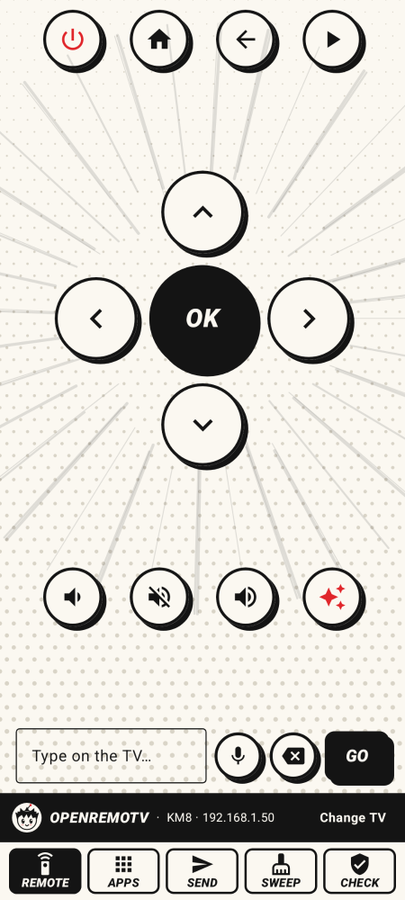
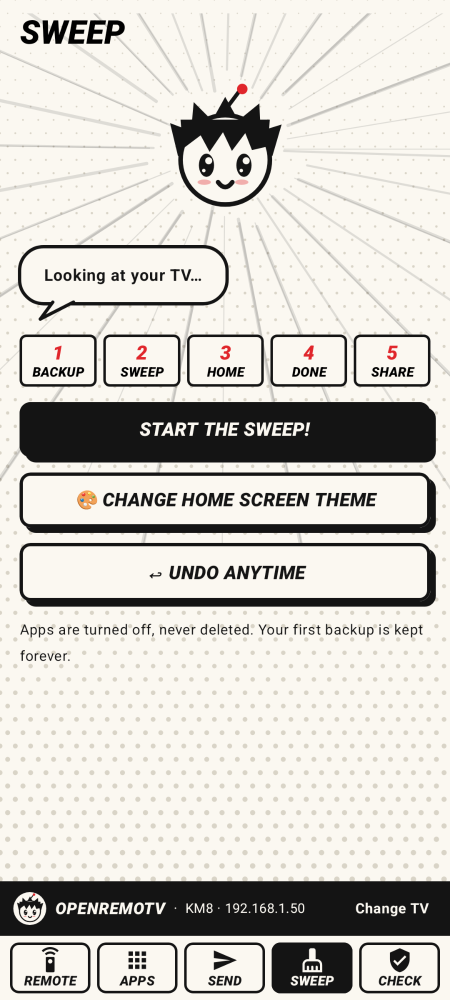
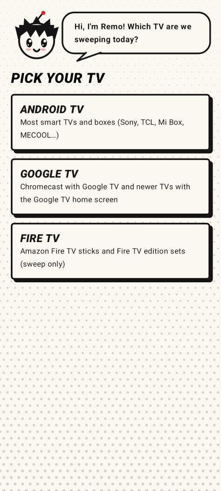
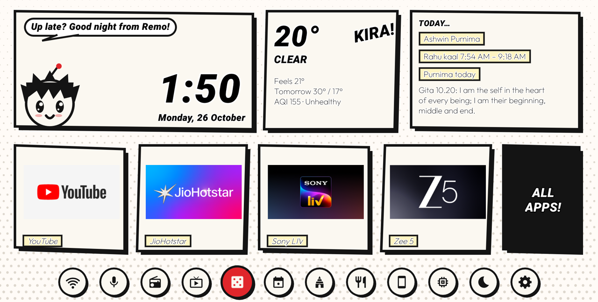

# OpenRemoTV

**OpenRemoTV is a free, open-source phone app that remotes, debloats and restyles Android TV, Google TV and Fire TV
over Wi-Fi, with no root.** It turns off the bloatware your TV came with (disabled, never uninstalled), backs
everything up first, and puts it all back with one tap. It also gives your TV a clean manga or India-themed home
screen.

<p>
  
  
  
</p>


## What it does

- **Remote.** Arrows, OK, Back, Home, play and pause, volume, mute, power, and typing on the TV. Keys land in about
  15 ms, and holding an arrow repeats it.
- **Apps.** Every app on the TV; tap one to open it on the TV.
- **Send.** A YouTube link plays on the TV; a photo, video or any file opens there. Share from YouTube, Photos or
  Files straight to OpenRemoTV.
- **Sweep (debloat).** Backup → pick the list for your TV's family (Sony, TCL, Xiaomi, Philips, Google TV, boxes, Fire TV) or the common list → choose apps → sweep →
  optional clean home screen → done → share it. **Undo anytime** goes back to your very first backup.
- **Check.** Finds apps a TV update switched back on, and turns them off again.
- **Two home screens.** **MangaHome**, a whole comic page with Remo the mascot, and **IndiaMinimalist**, with monuments
  and landscapes of India, the Panchang and festivals. Switch between them any time from the Sweep tab.
- **English and Hindi.**

## Install

1. Download the latest `OpenRemoTV-<version>.apk` from [Releases](../../releases) on your phone and open it
   (allow "Install unknown apps" for your browser or file manager).
2. On the TV, turn on developer options and network debugging. The app shows the exact steps for Android TV,
   Google TV and Fire TV.
3. Open OpenRemoTV, tap **Find my TV**, then **Connect**, and on the TV tick **Always allow** and press OK.

## FAQ

### How do I remove bloatware from Android TV without root?

Use ADB's "disable for this user" command (`pm disable-user`), which turns an app off without uninstalling it. Root
isn't needed, and every app can be turned back on. OpenRemoTV does this for you from your phone, one switch per
app, starting from the list for TVs like yours.

### Is it safe?

OpenRemoTV only disables apps, never uninstalls them, and it backs up first. Apps the TV needs to work (Android
itself, settings, the keyboard, the Play Store, remote pairing, the TV inputs) are locked and can't be switched off.
See [SECURITY.md](SECURITY.md).

### How do I undo it?

Open **Sweep** and tap **Undo anytime**. Every app that was on in your first backup comes back on, along with the
original home screen and animation speeds. **Sweep by hand** has an **Undo everything** button too.

### Which TVs work?

Any TV or box running Android TV or Google TV on Android 8 or newer, and Fire TV for sweeping. OpenRemoTV's lists
cover Sony, TCL, Xiaomi, Philips, Google TV, Android TV boxes and Fire TV, and a common list fits any other TV.
Apps the TV needs are locked whatever a list says.

### Does it collect any data?

No. There are no accounts, analytics or ads. See [PRIVACY.md](PRIVACY.md).

### Is network debugging left open?

ADB stays on until you turn it off. When you've finished sweeping, turn network debugging off again on the TV,
because ADB's port 5555 isn't encrypted.

## Build from source

You need JDK 17 and the Android SDK (platform 35, build-tools 35).

```bash
./gradlew :app:assembleRelease
```

That one command builds the TV helper (`keyserver/`) and the TV home screen (`homescreen/`), bundles both into the
app, and writes `app/build/outputs/apk/release/app-release.apk`. Without a release key it is signed with your debug
key; see [CONTRIBUTING.md](CONTRIBUTING.md) for tests, screenshots and signing.

## Repository layout

| Folder | What it is |
| --- | --- |
| `app/` | The phone app (Kotlin, Jetpack Compose): `tv/` talks to the TV, `sweep/` debloats and restores, `send/` sends links and files, `ui/` draws the manga screens |
| `app/src/main/assets/themes/` | The **MangaHome** and **IndiaMinimalist** themes: settings, wallpapers, captions and facts |
| `homescreen/` | **OpenRemoTV Home**, the TV home screen the themes run on (plain Java, one activity, two pages) |
| `keyserver/` | The small helper the app starts on the TV for instant keys, files and app switches |
| `docs/` | Screenshots and the project website |

## How it works

The phone talks to the TV with ADB over Wi-Fi (port 5555), approved once on the TV. For instant keys it then starts
a helper on the TV (port 8766). The helper answers only the phone that started it, and it signs in with an
HMAC challenge, so its secret never crosses the network. Picking a home screen installs OpenRemoTV Home and copies
the chosen theme's files into it.

## Contributing

Bug reports, TV lists, translations and themes are welcome. Start with [CONTRIBUTING.md](CONTRIBUTING.md) and the
[code of conduct](CODE_OF_CONDUCT.md). Report security problems privately, as [SECURITY.md](SECURITY.md) describes.

## Licence and credits

OpenRemoTV is released under the [MIT licence](LICENSE). The IndiaMinimalist
photos are from Wikimedia Commons under their own Creative Commons licences, credited in
[CREDITS.md](app/src/main/assets/themes/india/CREDITS.md). See [NOTICE.md](NOTICE.md) for everything else.
